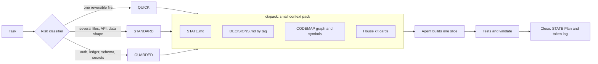
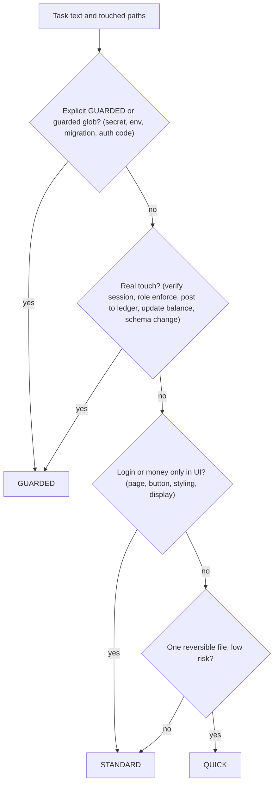
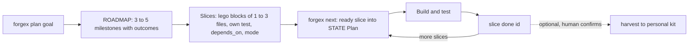
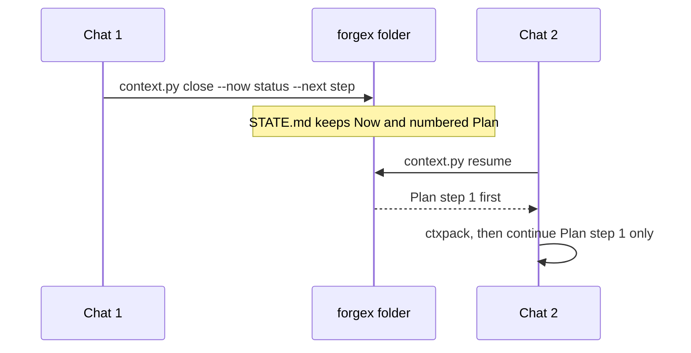

# FORGEX v2.9: Lean AI Engineering System

   

**Engineer the Plan. Execute with Precision.** · Small seeds, proven growth.

FORGEX helps AI coding agents (Cursor, Grok Bot, any agent that reads Markdown) work **fast, correctly and with few tokens**: risk-sized modes, a small context pack instead of the whole repo, a saved plan across chats, and your own house kit of reusable cards.

New here? Read **[QUICKSTART.md](QUICKSTART.md)** · Thai guide: **[INSTALL-TH.md](INSTALL-TH.md)** · Spec: [core/FORGEX.md](core/FORGEX.md)

## Why FORGEX
| | Without FORGEX | With FORGEX |
|---|---|---|
| Context | Agent re-reads the repo every chat | `ctxpack` loads STATE, tagged decisions, graph neighbours and matching cards within a token cap |
| Risk | Same ceremony for a CSS fix and a ledger write | QUICK / STANDARD / GUARDED from one classifier, never lowered |
| New chat | "Where were we?" | `context.py resume` prints the saved Plan, continue step 1 |
| Big features | One huge diff | Roadmap of 1-3 file slices, each with its own test |
| Style | Retyped every project | House kit cards, golden examples, `style capture` drafts |
| Claims | "Tests pass" (unrun) | Contracts validated, tests must call real code |

## How it works


## Risk modes

Unsure always goes higher; a mode is never lowered.

## Light planning (more than 3 slices only)

`plan --check` rejects cycles, slices over 3 files, missing deps or tests, and a first slice that is not walkable end to end. QUICK and single tasks skip planning.

## Cross-chat resume


## Commands cheat sheet
| Goal | Command |
|---|---|
| Context pack before coding | `python3 tools/ctxpack.py "<task>" --path <file>` |
| Start / save / resume context | `python3 tools/context.py init` · `close --now "…" --next "…"` · `resume` · `check` |
| Record a decision | `python3 tools/context.py decide "<d>" --why "<w>" --tag <area>` |
| Code map, graph, symbols | `python3 tools/codemap.py` · `related <file>` · `symbol <name>` |
| Contract for STANDARD/GUARDED | `python3 tools/scaffold.py standard\|guarded <id> "<goal>"` then `validate.py` |
| Plan a feature | `python3 tools/forgex.py plan "<goal>"` · `plan --check` · `next` · `slice done <id> --check-cmd "<test>"` |
| Harvest kit cards | `python3 tools/forgex.py harvest <slice-id>` · `--confirm <draft> --kit kits/<you>` |
| Capture a look | `python3 tools/forgex.py style capture <image-or-url...>` |
| Token log and report | `python3 tools/tokens.py log …` · `report` |
| Build both packages | `npm install && npm run build` or `python3 tools/build.py --public-only` |
| All tests | `python3 tools/test_risk.py && python3 tools/test_ctxpack.py && python3 tools/test_context.py && python3 tools/test_plan.py` |
| Release locally (never pushes) | `python3 tools/release.py` |

## Layout
```
core/           single source: FORGEX.md (spec), rules/, skill/SKILL.md, guides/, templates/ (STATE, DECISIONS, patterns…)
core/risk/      shared risk classifier (rules.json + classifier.py/.mjs), used by ctxpack and validate
core/house/     blank kit template (PROFILE, DESIGN, blocks/, golden/)
kits/<name>/    filled kits (personal or team); never shipped in the public package
config/         default-policy.json, kit.example.json (copy to kit.json to pick your kit)
schemas/ examples/ targets/cursor/ extras/
bench/          A/B test kit: FORGEX vs no FORGEX (README in Thai, tasks, starter, score.py)
tools/          scaffold.py, context.py, codemap.py, ctxpack.py, tokens.py, validate.py, validate.mjs, build.py, release.py, test_*.py, hooks/
```

## Outputs
- `dist/public/`: generic Cursor plugin + Grok Bot skill (+ source zip). Contains only the blank kit template. The build fails if any term from any `kits/*/private-terms.txt`, an email address or a secret-looking string appears in it.
- `dist/personal-<kit>/`: the same plus your kit at `references/kit/`. Keep it private.

## Roadmap
- v2.9 adds light planning (`forgex/roadmap.json` + `ROADMAP.md`), harvest drafts and style capture. Next: tune risk signals from bench numbers. No vector DB, no heavy ceremony. See core/FORGEX.md §11–12.

## License
MIT, © FORGEX contributors. See [LICENSE](LICENSE).

## Two places, one change (rule)
Every change updates **both** packages: the public one and every personal kit build. Run `python3 tools/release.py` after any edit; it rebuilds both, privacy-scans, validates, syncs the local bot copy and stages the public repo in `dist/public-repo/` with a local commit. Publishing (push + release) is always a separate, manual step.
